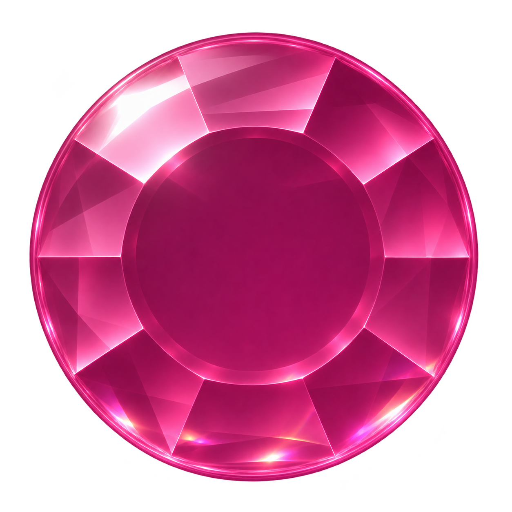
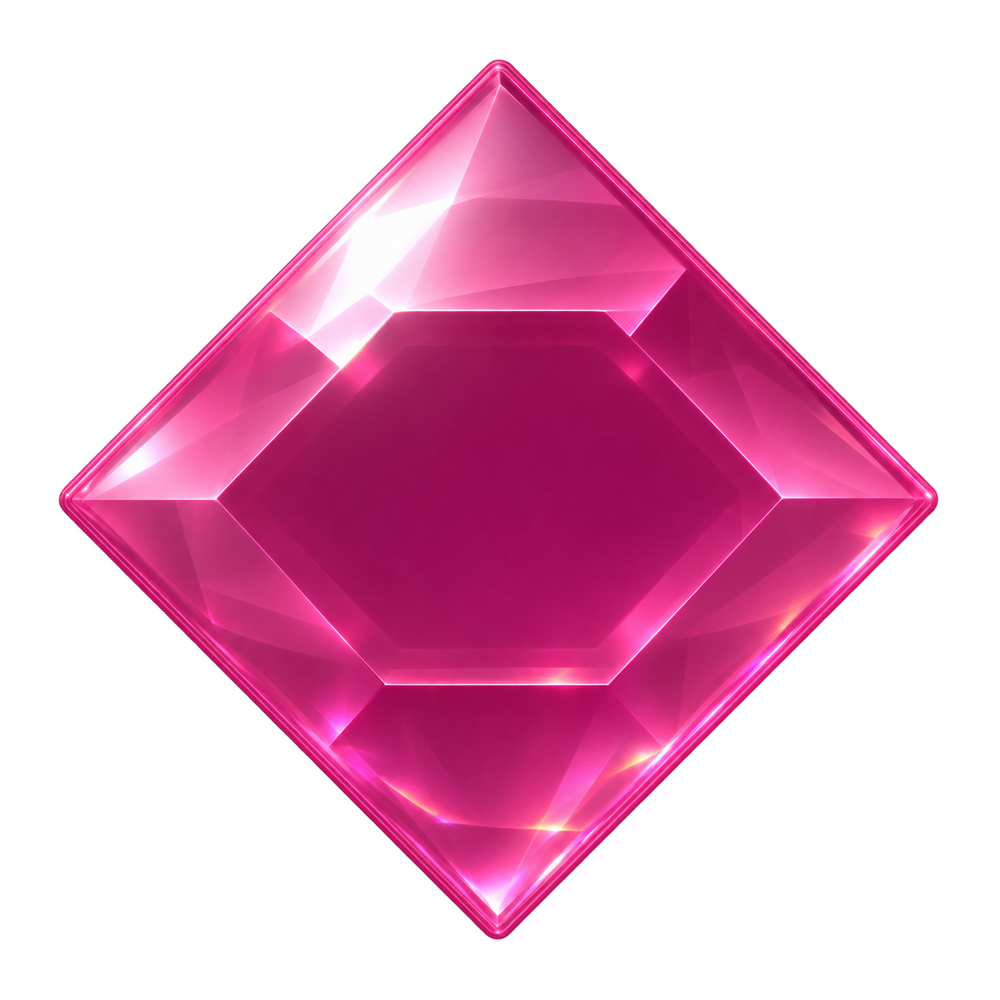
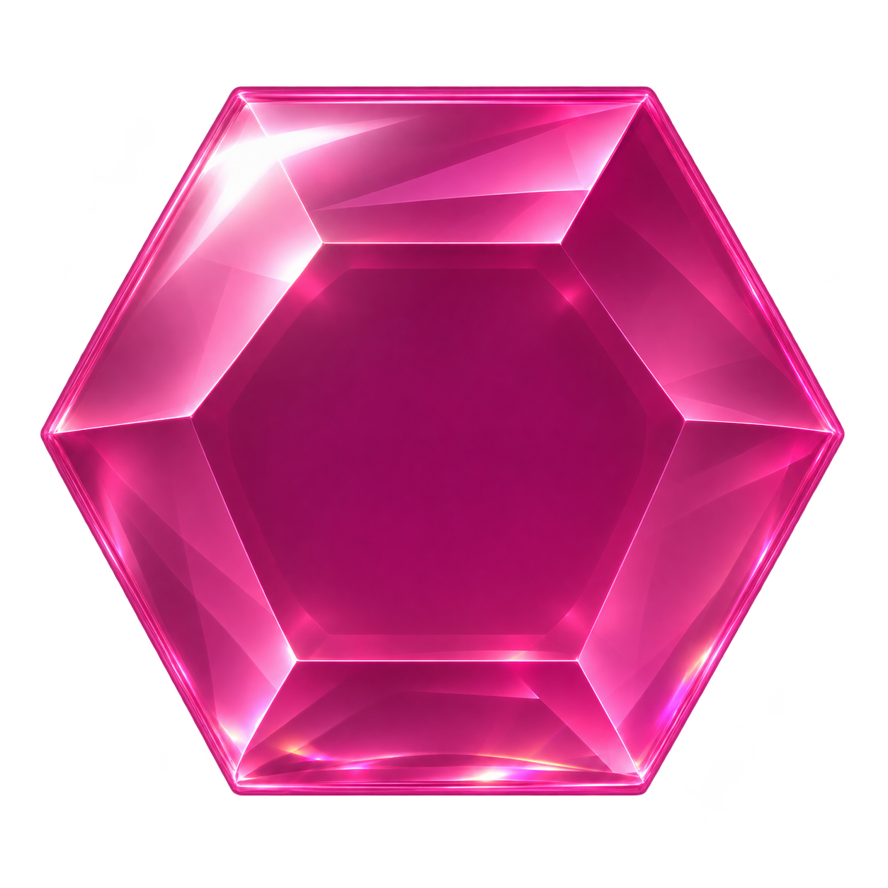
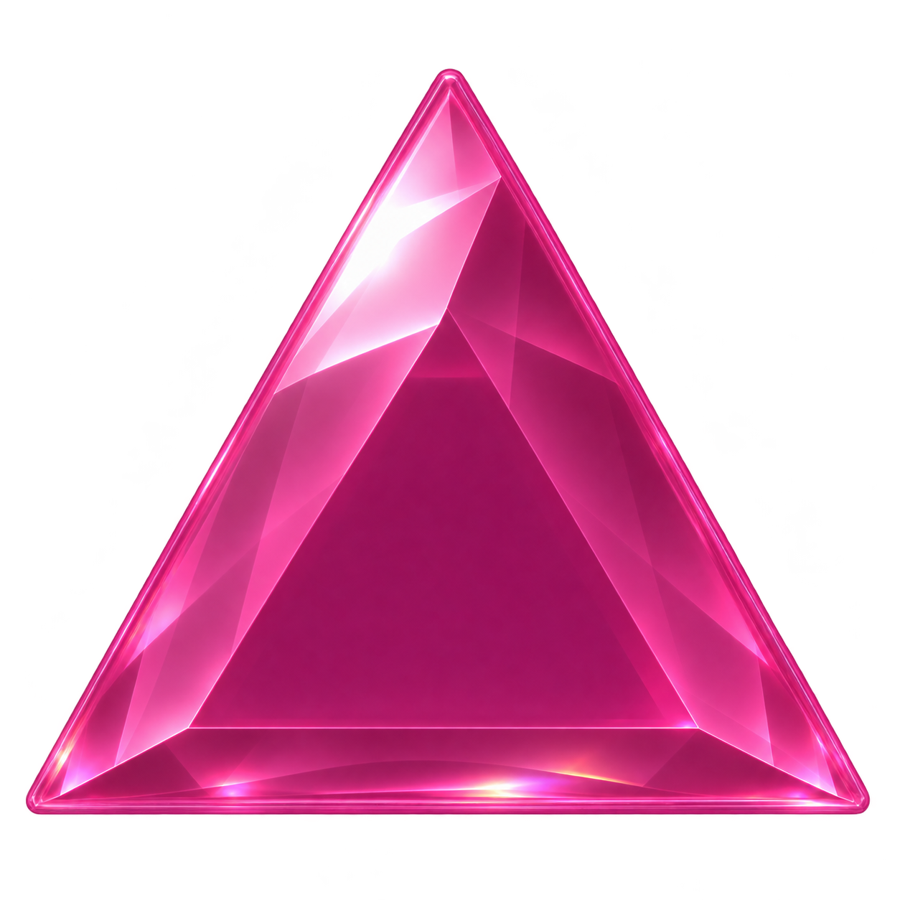
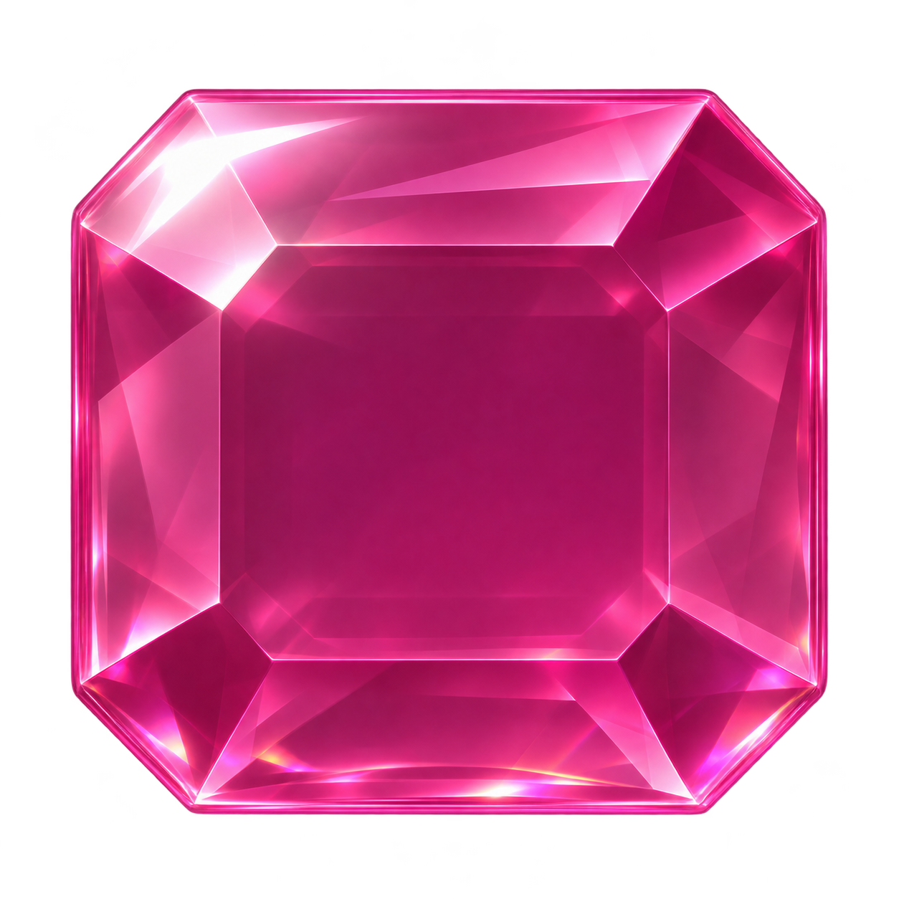
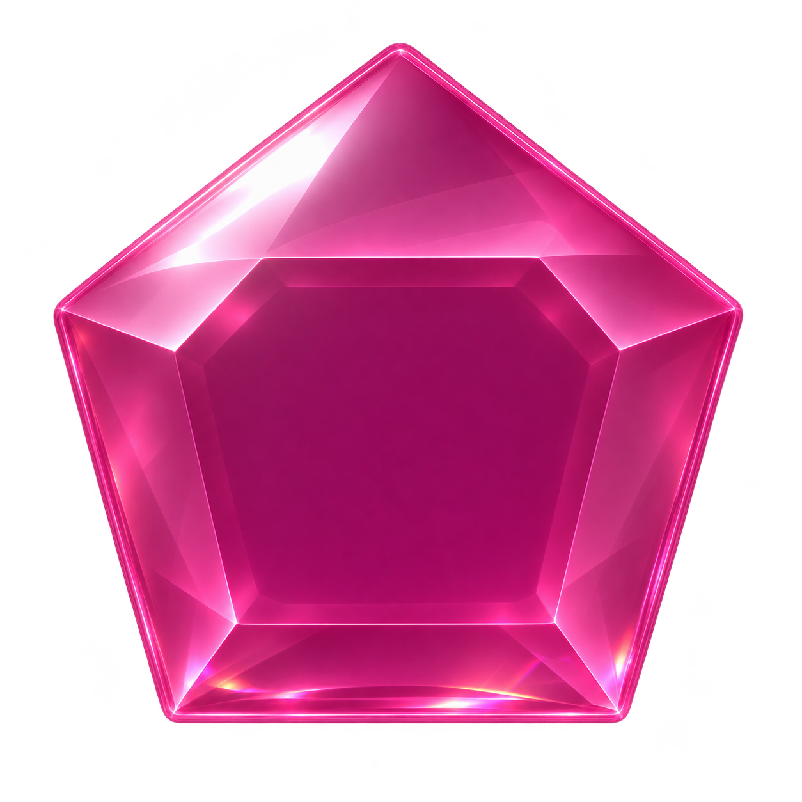
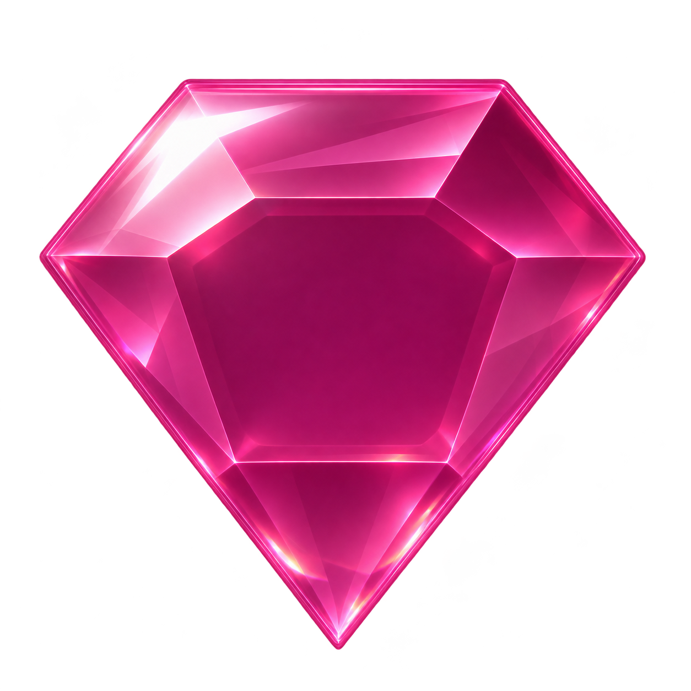

<div align="center">

# 🀄 Kanjidle — The Daily Kanji Sliding Puzzle · 漢字ポップ

### *Trò chơi giải đố trượt đá quý & hợp nhất nguyên tố học 24 Kanji N5*

<p align="center">
  
  
  
  
  
  
  
</p>

[](#)
[](#)
[](#)
[](#)
[](#)
[](#)

<p align="center">
  <a href="#-tính-năng-nổi-bật">Tính Năng</a> •
  <a href="#-cơ-chế-chơi-gameplay-mechanics">Cơ Chế Chơi</a> •
  <a href="#-hệ-thống-âm-thanh-sound-profiles">Hệ Thống Âm Thanh</a> •
  <a href="#-giáo-trình-24-kanji-n5">Giáo Trình N5</a> •
  <a href="#-khởi-chạy-cục-bộ-quickstart">Khởi Chạy</a> •
  <a href="#-bộ-kiểm-thử-tự-động">Kiểm Thử</a> •
  <a href="#-dành-cho-ai-agent">Dành Cho AI</a>
</p>

</div>

---

> [!IMPORTANT]
> 🤖 **Tài liệu bàn giao cho AI Agent (Antigravity, Cursor, Claude Code, GitHub Copilot, Codex, Aider)**:  
> Để AI quét toàn bộ kiến trúc, bảng tiến độ và các quy tắc bất biến mà không cần giải thích lại, vui lòng đọc trực tiếp file **[`AGENTS.md`](./AGENTS.md)**.

---

## 🌟 Tính Năng Nổi Bật

* 🧩 **Cơ chế Trượt & Ghép độc đáo (Sliding & Fusion)**: Bàn cờ 35 ô gồm 17 cặp ngọc cùng 1 ô trống duy nhất. Trượt các viên đá đồng màu, đồng dáng chạm cạnh nhau để kích hoạt hợp nhất Kanji.
* 🗺️ **Màn hình chính 3D Crystal Gemstone & Glassmorphism**: Bám sát ngôn ngữ thiết kế của logo Kanjidle Twin Gem Fusion, các đài ngọc 3D đa diện (Sapphire, Emerald, Amber, Amethyst, Crown Diamond), hiệu ứng hào quang mục tiêu 3 lớp, console hành trình kính mờ sắc nét 4K/Retina và tải nhanh tức thì (0MB asset ngoài).
* 🌐 **Đa ngôn ngữ song ngữ tức thì (i18n VI ↔ EN)**: Chuyển đổi 1-click giữa Tiếng Việt và Tiếng Anh cho toàn bộ giao diện, lộ trình, thẻ học và cài đặt.
* 🗣️ **Phát âm tiếng Nhật chuẩn (Native Audio TTS)**: Nút loa phát âm giọng Nhật bản xứ cho mọi chữ Kanji và từ vựng ví dụ.
* 📅 **Thử thách hàng ngày (Daily Kanji Puzzle)**: Mỗi ngày một câu đố chữ Hán phong cách Wordle/Kanjidle, tự động tạo thẻ chia sẻ chuỗi thắng cùng bạn bè.
* 🎛️ **Phòng thu âm thanh tương tác (Audio Studio)**: Cho phép nghe thử và tùy biến 10 phong cách âm thanh cho từng hành động (Chạm gạch, Hợp nhất, Chiến thắng, Nhạc nền J-Pop 126 BPM).
* 📱 **Bố cục thích ứng hoàn hảo (Smart Transposition)**:
  * **Mobile (< 900px)**: Bàn dọc $5 \times 7$ tối ưu thao tác 1 tay, phím bấm $\ge 44\text{px}$.
  * **Desktop ($\ge 900px$)**: Bàn ngang $7 \times 5$ hiển thị Kanji siêu lớn (~135px), không gian khoáng đạt.
  * Tự động hoán vị trục tọa độ khi xoay màn hình/resize mà **giữ nguyên 100% tiến trình chơi**.
* 💎 **Đồ họa đá quý Hybrid Clear Crystal**: 7 dáng cắt ngọc kết hợp giữa độ trong quang học và diện mạo góc cạnh bóng bẩy (Round, Diamond, Hexagon, Triangle, Square, Pentagon, Point).
* ✨ **Hiệu ứng Canvas VFX 8 nguyên tố ma thuật**: Hỏa (Lửa bốc), Thủy (Sóng cuộn), Băng (Pha lê tuyết), Sấm (Tia sét vàng), Mộc (Dây leo), Đất (Mảnh đá vỡ), Ma thuật (Vòng tròn ma pháp), Vũ trụ (Cực quang trôi).
* 📚 **Giáo trình 24 Kanji N5 có căn cứ khoa học**: 15 màn chơi qua 3 chương, cung cấp thẻ học toàn diện: Âm Hán Việt, Nghĩa, Công thức cấu tạo bộ thủ, Từ vựng thực tế và cách đọc Hiragana (đang mở rộng N4).
* 🔒 **Bảo toàn dữ liệu Schema v11**: Lưu trữ tự động `localStorage`, khóa Web Locks API chống ghi đè đa tab, xoay vòng backup và hỗ trợ xuất/nhập JSON an toàn.
* ⚡ **100% Zero-Build & Offline-First**: Chạy trực tiếp trên trình duyệt bằng ES Modules thuần, toàn bộ font chữ Noto Sans JP và Nunito lưu cục bộ WOFF2, không phụ thuộc internet.

---

## 🎮 Cơ Chế Chơi (Gameplay Mechanics)

```
        [Viên A]  --->  Trượt vào ô trống  --->  [Chạm cạnh Viên B]
                                                         │
                                                         ▼
                                                [HỢP NHẤT NGUYÊN TỐ]
                                                         │
                                                         ▼
                                                [MỞ THẺ KANJI N5]
                                                         │
                                                         ▼
                                            [TÁI SINH CẶP NGỌC MỚI]
                                           (Khoảng cách Manhattan ≥ 5)
```

1. **Trượt gạch**: Nhấp/kéo một viên đá nằm cạnh ô trống để di chuyển viên đá vào ô trống đó.
2. **Hợp nhất (Fusion)**: Khi 2 viên đá cùng màu và cùng hình dáng chạm cạnh nhau (theo chiều ngang hoặc dọc), chúng sẽ tự động kích hoạt hoạt họa va chạm nguyên tố.
3. **Thẻ học Kanji**: Màn hình hiển thị thẻ thông tin chữ Hán tương ứng, giải thích cấu tạo các bộ phận hợp thành chữ Kanji, phát âm và từ vựng thông dụng.
4. **Tái sinh ngọc thông minh (Refill Distance $\ge 5$)**: Khi cặp đá biến mất, cặp đá thay thế sẽ xuất hiện tại 2 vị trí cách nhau tối thiểu 5 bước Manhattan ($|x_1 - x_2| + |y_1 - y_2| \ge 5$), đảm bảo bàn cờ luôn thông thoáng và **không bao giờ bị deadlock**.

---

## 🎧 Hệ Thống Âm Thanh (Sound Profiles)

Kanjidle tích hợp bộ xử lý âm thanh **Web Audio API** chuyên nghiệp với hệ thống lọc đa tầng:
* `sfxBus`: Đi qua bộ lọc Lowpass 5200Hz giúp âm thanh va chạm đá ấm áp, loại bỏ tiếng chói gắt.
* `bgmBus`: Đi qua bộ lọc Lowpass 4000Hz giữ cho giai điệu BGM vui tươi (126 BPM) luôn êm dịu, không lấn át tiếng trượt ngọc.
* `masterBus`: Tích hợp bộ Dynamic Compressor chống méo tiếng / vỡ âm (clipping).

Người chơi có thể tùy chọn **5 phong cách âm thanh** trong phần Cài đặt:

| Sound Profile | Mã Profile | Cảm giác âm học | Mẫu âm thanh Foley |
| :--- | :---: | :--- | :--- |
| **Lướt gạch êm dịu** *(Mặc định)* | `'tile'` | Êm ái, đầm chắc, thỏa mãn xúc giác trượt đá | `audio/tile_slide.mp3` |
| **Đá quý va chạm** | `'gem'` | Trong trẻo, sáng rõ, tiếng đá quý cọ xát | `audio/gem_clink.ogg` |
| **Pha lê thanh thoát** | `'crystal'` | Âm bội cao vút, ngân vang tựa chuông gió | Synthesizer inharmonic modes |
| **Đá cờ vây** | `'stone'` | Tiếng quân cờ đá va vào bàn gỗ mộc mạc | `audio/go_stone_*.mp3` |
| **Ngọc bích** | `'soft'` | Trầm ấm, dịu nhẹ, tạo cảm giác thư giãn | Low-frequency stone slate |

---

## 📖 Giáo Trình 24 Kanji N5

Trò chơi được chia làm **3 Chương (15 Màn chơi)** bám sát từ vựng sơ cấp JLPT N5:

```
┌─────────────────────────────────────────────────────────────────────────────┐
│                               KANJIDLE N5                                   │
├───────────────────┬─────────────────────────────────────────────────────────┤
│ CHƯƠNG 1 (Màn 1-5) │  休 (Hưu)   男 (Nam)   分 (Phân)   名 (Danh)               │
│ Con người & Đời sống│  外 (Ngoại) 何 (Hà)    見 (Kiến)   国 (Quốc)               │
├───────────────────┼─────────────────────────────────────────────────────────┤
│ CHƯƠNG 2 (Màn 6-10)│  時 (Thời)  間 (Gian)  聞 (Văn)    話 (Thoại)              │
│ Thời gian & Giao tiếp│ 語 (Ngữ)   読 (Độc)   校 (Hiệu)   友 (Hữu)                │
├───────────────────┼─────────────────────────────────────────────────────────┤
│ CHƯƠNG 3 (Màn 11-15)│ 二 (Nhị)   三 (Tam)   天 (Thiên)  本 (Bản)                │
│ Số đếm & Tự nhiên │  白 (Bạch)  百 (Bách)  左 (Tả)     右 (Hữu)                │
└───────────────────┴─────────────────────────────────────────────────────────┘
```

Mỗi khi mở khóa thành công một chữ Kanji:
* Xem thẻ phân tích chi tiết các bộ thủ cấu thành (ví dụ: `亻` [Người] + `木` [Cây] $\rightarrow$ `休` [Nghỉ ngơi]).
* Nghe âm thanh phát âm và xem ví dụ từ vựng kèm Hiragana phiên âm chuẩn.
* Lưu vào **Album Kanji** cá nhân để ôn tập bất cứ lúc nào.

---

## 🚀 Khởi Chạy Cục Bộ (Quickstart)

### 1. Yêu cầu hệ thống
* Đã cài đặt [Node.js](https://nodejs.org/) (khuyến nghị phiên bản 18+ trở lên).
* Trình duyệt hiện đại hỗ trợ ES Modules (Chrome, Safari, Edge, Firefox).

### 2. Tải mã nguồn & Khởi động
```bash
# 1. Clone repository
git clone https://github.com/quangthanh66/KanjiPop.git
cd KanjiPop

# 2. Di chuyển vào thư mục web và chạy server
cd work/kanji-pop-site
node server.js
```

### 3. Trải nghiệm game
Mở trình duyệt bất kỳ và truy cập đường dẫn:
👉 **`http://127.0.0.1:8765/`**

---

## 🧪 Bộ Kiểm Thử Tự Động (Automated Test Suite)

Dự án tích hợp sẵn các bộ kịch bản kiểm thử Playwright Headless kiểm tra tự động toàn bộ logic:

```bash
# Đảm bảo local server đang chạy trên cổng 8765, sau đó mở terminal mới tại root:

# 1. Kiểm tra toàn diện cơ chế Hợp nhất (Fusion VFX) & Hiển thị thẻ Kanji:
node work/fusion-check.cjs

# 2. Kiểm tra điều hướng toàn bộ UI Shell (Lộ trình -> Bàn chơi -> Menu -> Album):
node work/ui-shell-check.cjs

# 3. Kiểm tra độ ổn định Layout trên 6 kích thước màn hình (320px đến 1440px):
node work/mobile-layout-stability-check.cjs

# 4. Kiểm tra Lộ trình hành trình 3 chương:
node work/journey-map-check.cjs
```

---

## 📁 Cấu Trúc Thư Mục Dự Án

```
KanjiPop/
├── AGENTS.md                   # 🤖 Bảng đặc tả toàn diện dành riêng cho AI Coding Agents
├── README.md                   # 📖 Tài liệu giới thiệu tổng quan dự án (File này)
├── .gitignore                  # Bỏ qua screenshots Playwright (~93MB) và file tạm
│
└── work/
    ├── kanji-pop-site/         # Thư mục chính của ứng dụng Web
    │   ├── server.js           # Server tĩnh Node.js phục vụ port 8765
    │   ├── GAMEPLAY.md         # Toàn bộ nhật ký thiết kế & lịch sử kỹ thuật
    │   ├── art-source/         # File ảnh gốc, prompt AI sinh sprite, atlas VFX
    │   │
    │   └── dist/               # Thư mục phục vụ Web (Chạy trực tiếp trên trình duyệt)
    │       ├── index.html      # Trang chủ game & cấu trúc DOM
    │       ├── n5-game.js      # Controller chính: Quản lý vòng lặp, Touch/Mouse, UI
    │       ├── n5-engine.js    # Bàn cờ thuần: Tính toán di chuyển, solver BFS, refill
    │       ├── n5-data.js      # Bộ dữ liệu 24 Kanji N5 (Hán Việt, bộ thủ, từ vựng)
    │       ├── audio-fx.js     # Web Audio API Engine: 5 sound profiles, BGM 126 BPM
    │       ├── fusion-fx.js    # Canvas 2D VFX: Hoạt họa va chạm nguyên tố khi hợp nhất
    │       ├── target-vfx.js   # Hiệu ứng hào quang mục tiêu 3 lớp bám viền đá quý
    │       ├── gem-art.js      # Vector & WebP sprite renderer cho 7 dáng đá quý
    │       ├── course-plans.js # 30 lộ trình giải mẫu đã xác thực (15 Mobile + 15 Desktop)
    │       ├── progress-store.js # Lưu tiến trình localStorage, backup, export/import JSON
    │       ├── progress-lock.js  # Khóa Web Locks API chống xung đột đa tab
    │       ├── aurora-background.js # Canvas nền cực quang và sao trôi lơ lửng
    │       ├── audio/          # Bộ file âm thanh Foley thực tế (*.mp3, *.ogg, *.wav)
    │       ├── fonts/          # Font Noto Sans JP và Nunito WOFF2 offline
    │       └── *.css           # Toàn bộ hệ thống giao diện responsive
    │
    └── *.cjs                   # Bộ kịch bản kiểm thử tự động Playwright
```

---

## 🤖 Dành Cho AI Agent

Nếu bạn là một **AI Agent** tiếp quản dự án này trên thiết bị mới:
1. Hãy đọc file **[`AGENTS.md`](./AGENTS.md)** ngay lập tức.
2. Nắm vững **6 Quy tắc bất biến** (Không thêm build tool, duy trì bàn cờ 35 ô, không mang obstacles quay lại, quy tắc khoảng cách Manhattan $\ge 5$, cấu trúc âm thanh đơn nhịp).
3. Đảm bảo chạy `node work/fusion-check.cjs` và `node work/ui-shell-check.cjs` sau mỗi thay đổi lớn để đảm bảo không xảy ra hồi quy (regression).

---

## 📜 Giấy Phép & Bản Quyền (License & Credits)

* **Mã nguồn**: Phát triển theo giấy phép **MIT License**.
* **Font chữ**: [Noto Sans JP](https://fonts.google.com/noto/specimen/Noto+Sans+JP) và [Nunito](https://fonts.google.com/specimen/Nunito) theo giấy phép **SIL Open Font License (OFL)**.
* **Tác giả**: Được phát triển và hoàn thiện bởi [`quangthanh66`](https://github.com/quangthanh66).

<div align="center">
  <sub>Made with ❤️ for Vietnamese Japanese learners • 2026</sub>
</div>
